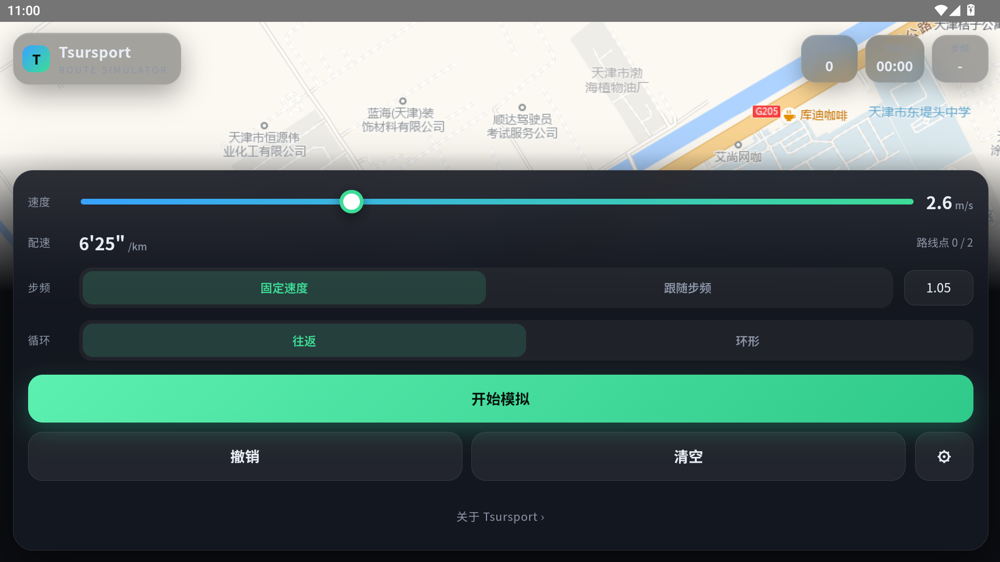
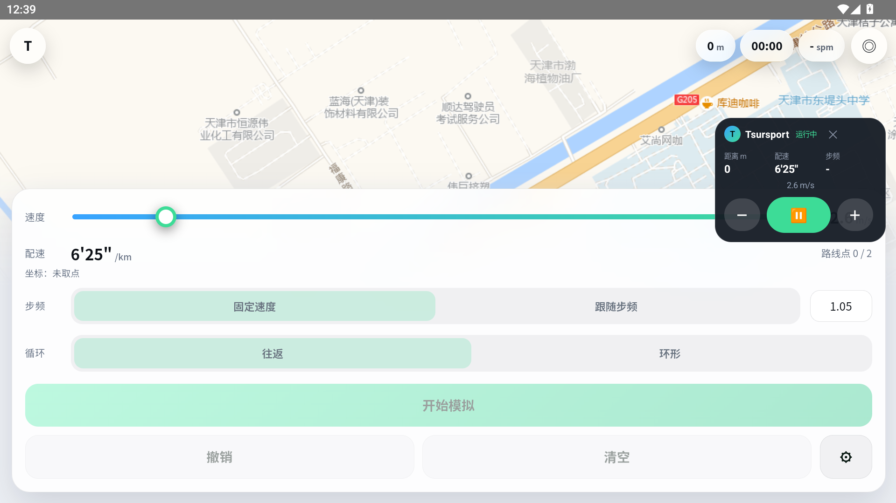
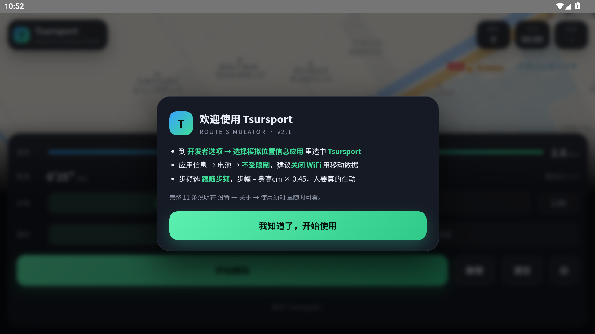
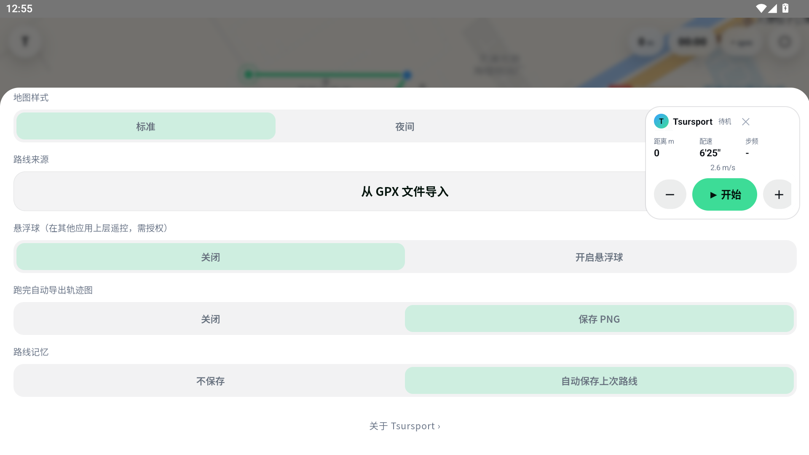

# Tsursport

> 免 root 的 Android 定位模拟 / 配速 / 步频跟随工具 —— 用于自有设备上的定位与运动数据调试、演示。

<p align="center">
  
</p>

<p align="center">
  
  
  
  
</p>

---

## 目录

- [这是什么](#这是什么)
- [功能](#功能)
- [截图](#截图)
- [安装](#安装)
- [第一次使用](#第一次使用)
- [设置项说明](#设置项说明)
- [悬浮窗](#悬浮窗)
- [自己编译](#自己编译)
- [工作原理](#工作原理)
- [能力边界（重要）](#能力边界重要)
- [常见问题](#常见问题)
- [项目结构](#项目结构)
- [更新日志](#更新日志)
- [许可](#许可)

---

## 这是什么

一个只有 **101 KB** 的 Android 应用：在地图上画一条路线，它可以按你设定的配速，
把系统的 GPS 位置沿着路线"走"出来，并且用你**真实的步频**驱动速度，让速度、配速、步频三者自洽。

不需要 root，不需要 Xposed / LSPosed，不需要刷机。

适合：

- 调试自己的定位类 / 运动类应用（不用真的跑到操场上）
- 演示轨迹回放、配速计算、步频匹配
- 在模拟器或真机上验证「位置变化 → 应用行为」的完整链路

## 功能

| 功能 | 说明 |
|---|---|
| 🗺️ 地图画路线 | 点地图连续取点，支持撤销 / 清空 / 往复 / 环形闭环 |
| ⏱️ 配速控制 | 0.8 – 15 m/s 无级调节，实时显示配速（1'06" – 20'50" /km） |
| 👟 步频跟随 | 读取真实计步器，`速度 = 步频 × 步幅`，可调步幅 |
| 📡 四路注入 | `gps` / `network` / `fused` + 厂商自定义 provider 全量接管 |
| 🎛️ 数据自然化 | 精度 12–28 m、速度 ±8%、航向 ±3°、卫星数 / CN0 随机 |
| 🫧 悬浮窗 | 进程级悬浮面板，退出 App 仍在；可拖动、可收成小球、可暂停调速 |
| 📥 GPX 导入 | 支持标准 GPX（trkpt / rtept），自动抽稀并换算坐标系 |
| 🖼️ 轨迹图导出 | 跑完自动生成 1080×1350 的轨迹卡片 PNG |
| 🌗 主题 | 浅色 / 深色，顶部、卡片、悬浮窗统一跟随 |
| 📐 三套坐标 | 内部 GCJ-02，注入前转 WGS-84，可切换 BD-09 显示以便和百度地图核对 |

## 截图

| 主界面 | 悬浮窗 |
|---|---|
|  |  |

| 首次启动 | 悬浮窗在桌面常驻 |
|---|---|
|  |  |

| 设置页 | 应用图标 |
|---|---|
|  |  |

## 安装

1. 从 [Releases](../../releases) 下载最新的 `Tsursport.apk`
2. 手机上允许「安装未知来源应用」后安装
3. 系统要求：**Android 10（API 29）及以上**，无需 root

也可以本地编译，见 [自己编译](#自己编译)。

## 第一次使用

首次打开会弹出说明页，读完点「我已阅读，开始使用」。然后按顺序做四件事：

**1）把 Tsursport 设为模拟位置应用**

```
设置 → 开发者选项 → 选择模拟位置信息应用 → Tsursport
```

> 需要先开启开发者选项：设置 → 关于手机 → 连点「版本号」7 次。
> 换版本或重启后这项可能被清空，每次使用前确认一次。

**2）关掉电池优化**

```
设置 → 应用 → Tsursport → 电池 → 不受限制
```

并关闭系统的「深度休眠 / 自动优化」，否则后台服务被杀，定位会跳回真实位置。

**3）授予权限**

- 位置信息（精确）
- 身体活动 / 健身运动（用于读取步频，Android 10+ 必需）
- 通知（前台服务提示）
- 显示在其他应用上层（仅悬浮窗需要）

**4）画路线 → 开始**

在地图上点出 2 个以上的点，选好速度和循环方式，点「开始模拟」。

## 设置项说明

| 设置 | 作用 |
|---|---|
| **定位真实度** | 稳定 / 标准 / 高仿真 —— 控制水平精度区间与抖动幅度 |
| **卫星数据** | 是否往 `Location.extras` 写入 `satellites` / `meanCn0` / `maxCn0` |
| **速度抖动** | 匀速或 ±8% 自然抖动 |
| **界面主题** | 浅色（默认）/ 深色，整套 UI 跟随 |
| **地图样式** | 标准 / 夜间 / 卫星（夜间为高德瓦片 + 暗色滤镜，纯本地渲染） |
| **坐标对齐百度** | 坐标文本按 BD-09 显示，便于和百度地图核对 |
| **路线来源** | 从 GPX 文件导入 |
| **悬浮球** | 开启进程级悬浮控制面板 |
| **跑完自动导出** | 停止时保存轨迹卡片 PNG |
| **路线记忆** | 自动保存上次路线，下次打开自动恢复 |
| **关于** | 版本信息、完整使用须知 |

## 悬浮窗

点悬浮窗标题栏可以**收成一个 54 dp 的圆球**，点圆球再展开；按住标题栏可以拖到屏幕任意位置。

```
┌─────────────────────────────┐
│ (T) Tsursport  运行中   ✕   │
├─────────────────────────────┤
│  距离 m      配速      步频  │
│    0        6'25"       -   │
│         2.6 m/s             │
├─────────────────────────────┤
│   (－)     ( ⏸ )     (＋)   │
└─────────────────────────────┘
```

| 状态 | 中间按钮 | 颜色 |
|---|---|---|
| 未开始 | `▶ 开始` | 绿 |
| 运行中 | `❚❚ 暂停` | 琥珀 |
| 已暂停 | `▶ 继续` | 绿 |

- 悬浮窗由 **ApplicationContext** 持有，退出 App、切到桌面依然存在
- 开启状态记在 `SharedPreferences`，重开 App 自动恢复
- `－` / `＋` 每次调速 0.3 m/s（跟随步频模式下速度由步频决定，此键不生效）

## 自己编译

项目**不需要 Gradle**，用 SDK 自带的工具链直接打包，全程几秒钟。

### 依赖

| 组件 | 版本要求 |
|---|---|
| JDK | 11+（`javac` / `keytool`） |
| Android SDK | build-tools（`aapt2` `d8` `zipalign` `apksigner`）+ 任一 `android.jar`（API 29+） |

### 命令

```powershell
# 让脚本自己找 SDK / JDK
$env:ANDROID_HOME = "C:\Users\you\AppData\Local\Android\Sdk"
$env:JAVA_HOME    = "C:\Program Files\Java\jdk-17"

powershell -ExecutionPolicy Bypass -File .\build.ps1
```

产物：`Tsursport.apk`，同时打印 SHA-256。

指定路径：

```powershell
.\build.ps1 -Sdk "D:\Android\Sdk" -VersionName "2.1" -VersionCode 21
```

首次构建会在 `.keystore/` 生成调试签名（已在 `.gitignore` 中排除）。

### 构建流程

```
javac   → 编译单文件 Java 源码
d8      → 生成 classes.dex
aapt2   → 编译 res/ 并链接 manifest（含 @mipmap/ic_launcher）
zip     → 把 classes.dex 与 assets/ 塞进 APK
zipalign -p 4
apksigner → 调试签名
```

## 工作原理

### 定位注入

Android 给普通应用开放了「测试位置提供者」：

```java
LocationManager.addTestProvider(name, false, requiresNetwork, false,
                                false, true, true, true, /*powerUsage*/ 1, /*accuracy*/ 1);
LocationManager.setTestProviderEnabled(name, true);
LocationManager.setTestProviderLocation(name, location);   // 每秒推送
```

注意点：

- `powerUsage` / `accuracy` 必须在 **1..3**，否则抛 `IllegalArgumentException`
- `passive` provider **不允许** mock，需要跳过
- 已存在的同名单 provider 要先 `removeTestProvider`

本项目对 `gps`、`network`、`fused` 以及运行时枚举到的所有 provider 同时注入，
避免地图 SDK 从别的通道读到真实位置。

### 坐标系

```
WGS-84   系统 Location 标准（也是 GPX 标准）
GCJ-02   高德 / 支付宝等国内地图
BD-09    百度地图（在 GCJ 上再偏移一次）
```

内部统一用 **GCJ-02**（与界面地图一致）：

- 注入前：GCJ → WGS
- 显示前：WGS → GCJ
- GPX 导入：WGS → GCJ
- 「坐标对齐百度」：仅影响文本显示，GCJ → BD-09

### 步频跟随

```
速度 = 步频(spm) × 步幅(m) ÷ 60
```

步频来自系统计步器（`TYPE_STEP_DETECTOR` / `TYPE_STEP_COUNTER`），
这样"位置推进速度"与"真实步频"天然一致，不会出现「位置在跑、腿上没步」的矛盾。

## 能力边界（重要）

**能做到**

- 系统定位（经纬度、精度、速度、航向、海拔、卫星信息）全量替换
- 轨迹、里程、配速按设定推进
- 悬浮窗在任意界面遥控

**做不到（免 root 的硬限制）**

| 项 | 原因 |
|---|---|
| 抹掉 `Location.isMock()` 标记 | 框架层字段，只有 hook 才能改 |
| 伪造步数 / 步频读数 | 传感器只读，`SensorManager` 无写入接口 |
| 拦截 App 自采的 WiFi / 基站 / IP 定位 | 那些请求不经过 `LocationManager` |
| 伪造 GNSS 卫星、NMEA | 需要系统级权限 |
| 绕过模拟器 / root / 设备指纹检测 | 属于风控指纹范畴 |

因此：**位置可以模拟，运动必须真实发生**。

## 常见问题

**Q：开始按钮点了没反应，提示"还没被选为模拟位置信息应用"？**
A：去 设置 → 开发者选项 → 选择模拟位置信息应用，选中 Tsursport。每次重装/重启后要重新选。

**Q：跑了一段位置又跳回真实位置？**
A：三种可能：① 电池优化杀了后台服务；② 目标 App 用自带 SDK 自采网络定位；③ 后台服务被系统冻结。对应处理：设电池不受限、关 WiFi、加锁任务列表。

**Q：步频一直显示 `-`？**
A：没读到计步器。检查「身体活动」权限；模拟器没有计步器硬件，真机才有数据。

**Q：地图上的点和百度地图对不上？**
A：百度用 BD-09，与高德/支付宝的 GCJ-02 本身差 200–500 m。设置里打开「坐标对齐百度」可以按 BD-09 显示。

**Q：悬浮窗消失了？**
A：进程被系统杀掉会一起消失。确保电池不受限；正常情况下退出 App 不会消失。

**Q：夜间地图空白？**
A：夜间用的是高德瓦片 + 本地滤镜，首次切换需要联网加载瓦片。

## 项目结构

```
Tsursport/
├─ build.ps1                    无 Gradle 构建脚本
├─ app/
│  ├─ AndroidManifest.xml
│  ├─ src/com/tsursport/Tsursport.java     单文件实现（Activity + Service + 悬浮窗 + JS 桥）
│  ├─ assets/
│  │  ├─ index.html                        WebView 界面（地图 / 控制 / 设置）
│  │  ├─ leaflet.js  leaflet.css           离线地图库
│  └─ res/mipmap-*/ic_launcher.png         五套密度图标
├─ docs/screens/                截图
├─ CHANGELOG.md
├─ LICENSE
└─ README.md
```

## 更新日志

见 [CHANGELOG.md](CHANGELOG.md)。

## 许可

[MIT](LICENSE) © 林忆知遥

> 本项目仅用于自有设备上的定位与运动数据调试、演示。请在遵守所在平台规则的前提下使用。
